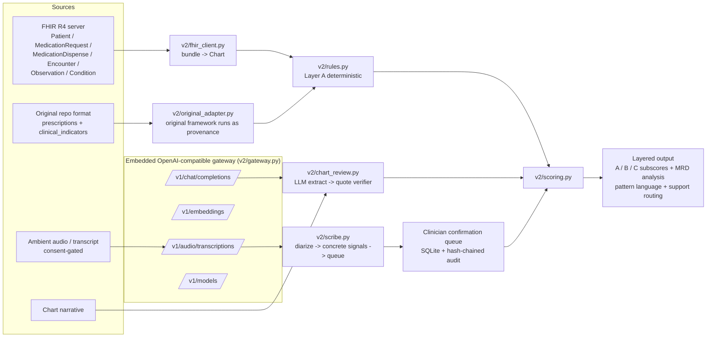

# ARCHITECTURE.md — v2

## Components

- **`v2/gateway.py`** — OpenAI-compatible gateway. Backends: `stub` (deterministic offline extractor + hashing embeddings + demo STT transcript — all labelled stub), `local` (Ollama/llama.cpp at `AI_BASE_URL`, local Whisper-style STT at `AI_STT_BASE_URL`), `upstream` (any OpenAI-compatible API via `AI_API_KEY`; BAA warning in SECURITY.md).
- **`v2/fhir_client.py`** — async FHIR R4 client (search by patient) + bundle mapper. Drug class via a small name lexicon (production must bind RxNorm/ATC — known limit, see mapper docstring). Dose math: doseQuantity × frequency/period → daily mg.
- **`v2/rules.py`** — Layer A deterministic rules over the Chart model: prescriber/pharmacy counts, date-overlap (opioid×benzo), early-refill date arithmetic, MME tiers + escalation, guideline-exempt context suppression.
- **`v2/chart_review.py` + `v2/verify.py`** — Layer B. LLM proposes flags with verbatim quotes; verifier (exact / ≥0.9 token-overlap) disposes. Dropped flags are counted in the API response.
- **`v2/scribe.py`** — consent gate (raises `ConsentError`), diarizers behind an interface (prefix parser for labelled text; pause-based stub for timestamped segments, labelled as a heuristic), and the five concrete content-signal extractors. No state/intent detection.
- **`v2/contradictions.py`** — the MRD Escalator (Materiality × Repetition × Directionality) for history–chart contradictions.
- **`v2/original_adapter.py`** — translates Raphael's original input format, and runs the original `EvidenceBasedEvaluation` for side-by-side provenance.
- **`v2/store.py`** — SQLite persistence, confirmation queue, hash-chained audit log.
- **`app_v2.py`** — FastAPI surface: gateway at `/v1/*`, scoring at `/score`, `/fhir/score`, `/fhir/bundle/score`, `/v2/score/original-format`, scribe at `/scribe/*`, queue at `/queue`, audit at `/audit`, demo UI at `/`. The legacy v1 API (`main.py`, `/api/v1/*`) is unchanged.

## Legacy v1 (preserved)

`models/`, `data/`, `services/` (Gradient Boosting model, SHAP/LIME XAI, evaluation framework, risk calculator with the original 0.6/0.3/0.1 blend) remain in place and importable. v2 does not silently replace them; SCORING.md maps every factor and explains each change.
